# SP9 issue tracker (Markdown)

One file per tangible problem, linking every report, patch, PR and upstream submission we found to it.
Generated from `issues/src/*.yaml` by `tools/build_issues.py`; edit the YAML and rerun.
Each file has YAML front matter (id, title, labels, depends_on, blocks, related) so it can be parsed or
imported into GitHub later; `issues.json` has title, body and labels per issue.

54 issues. Status: fix-pending 15, fixed-upstream 1, needs-test 8, open 29, tracking 1

Status vocabulary: `open` (problem, no fix posted), `fix-pending` (a fix exists in a PR, branch or on a
list), `needs-test` (needs data from a real SP9), `fixed-upstream` (kept for traceability), `tracking`.

Reference index (every external link and the issues citing it): [refs.md](refs.md).

## All issues

| ID | Title | Area | Priority | Status | Mainline | linux-surface | Fedora |
|---|---|---|---|---|---|---|---|
| [SP9-101](SP9-101-touchscreen-and-pen-need-the-out-of-tree-ithc-driver-no-upst.md) | Touchscreen and pen need the out-of-tree ITHC driver (no upstream driver for the ADL THC in legacy mode) | touch | P1 | open | broken | works | broken |
| [SP9-102](SP9-102-iptsd-is-not-packaged-in-fedora.md) | iptsd is not packaged in Fedora | touch | P1 | open | n/a | works | broken |
| [SP9-103](SP9-103-touch-and-pen-stop-working-after-suspend-resume.md) | Touch and pen stop working after suspend/resume | touch | P1 | open | n/a | partial | broken |
| [SP9-105](SP9-105-iptsd-service-and-udev-rule-are-fragile-stops-after-cold-boo.md) | iptsd service and udev rule are fragile (stops after cold boot, probes every hidraw, loses its tag) | touch | P1 | fix-pending | n/a | partial | n/a |
| [SP9-201](SP9-201-type-cover-does-not-work-at-the-luks-passphrase-prompt-dracu.md) | Type Cover does not work at the LUKS passphrase prompt (dracut lacks surface_aggregator_hub) | cover | P1 | open | works | works | broken |
| [SP9-202](SP9-202-type-cover-dead-or-slow-after-boot-sam-probe-returns-einval.md) | Type Cover dead or slow after boot: SAM probe returns -EINVAL before the pin controller is ready | cover | P1 | fix-pending | partial | works | partial |
| [SP9-203](SP9-203-boot-stalls-about-2-minutes-surface-hid-probes-the-pen-stash.md) | Boot stalls about 2 minutes: surface_hid probes the pen stash node and fails with -EPROTO | cover | P1 | open | broken | broken | broken |
| [SP9-206](SP9-206-rotation-and-light-sensor-hang-in-iio-sensor-proxy-claims-ti.md) | Rotation and light sensor hang in iio-sensor-proxy (claims time out, rotation freezes) | sensors | P1 | open | partial | partial | broken |
| [SP9-301](SP9-301-opening-the-cover-does-not-wake-the-sp9-surface-gpe-has-no-s.md) | Opening the cover does not wake the SP9 (surface_gpe has no SP9 entry) | lid | P1 | open | broken | partial | broken |
| [SP9-302](SP9-302-sp9-sometimes-does-not-wake-from-s2idle-or-hangs-on-the-seco.md) | SP9 sometimes does not wake from s2idle (or hangs on the second suspend) | suspend | P1 | open | partial | partial | partial |
| [SP9-401](SP9-401-front-camera-ov5693-returns-empty-buffers-on-mainline-7-4-2x.md) | Front camera (OV5693) returns empty buffers on mainline 7.4: 2x2 binned mode with flips fails | camera | P1 | fix-pending | partial | partial | broken |
| [SP9-601](SP9-601-installing-and-booting-fedora-on-the-sp9-with-secure-boot-nx.md) | Installing and booting Fedora on the SP9 with Secure Boot (NX firmware, MOK, boot entries) | boot | P1 | needs-test | works | partial | unknown |
| [SP9-901](SP9-901-baseline-test-of-an-sp9-on-stock-fedora-logs-ids-initramfs-p.md) | Baseline test of an SP9 on stock Fedora (logs, IDs, initramfs, per-feature check) | meta | P1 | needs-test | unknown | unknown | unknown |
| [SP9-903](SP9-903-goal-sp9-fully-usable-on-the-stock-fedora-kernel-and-package.md) | Goal: SP9 fully usable on the stock Fedora kernel and packages | meta | P1 | tracking | partial | works | partial |
| [SP9-104](SP9-104-ithc-fails-to-initialise-on-some-boots-or-units-efi-stub-dma.md) | ITHC fails to initialise on some boots or units (EFI stub DMA error, legacy init -110) | touch | P2 | needs-test | n/a | partial | n/a |
| [SP9-106](SP9-106-erratic-touch-detection-and-weak-palm-rejection-with-default.md) | Erratic touch detection and weak palm rejection with default iptsd settings | touch | P2 | fix-pending | n/a | partial | n/a |
| [SP9-107](SP9-107-slim-pen-2-report-rate-is-about-66-hz-jagged-fast-strokes.md) | Slim Pen 2 report rate is about 66 Hz (jagged fast strokes) | pen | P2 | fix-pending | n/a | partial | n/a |
| [SP9-108](SP9-108-slim-pen-2-phantom-button-and-eraser-events.md) | Slim Pen 2 phantom button and eraser events | pen | P2 | fix-pending | n/a | partial | n/a |
| [SP9-111](SP9-111-libwacom-has-no-sp9-tablet-description-pen-and-touch-not-rec.md) | libwacom has no SP9 tablet description (pen and touch not recognised as a tablet) | pen | P2 | open | n/a | works | broken |
| [SP9-112](SP9-112-package-ithc-as-a-signed-out-of-tree-module-akmod-kmod-for-t.md) | Package ITHC as a signed out-of-tree module (akmod/kmod) for the stock Fedora kernel | touch | P2 | open | n/a | n/a | broken |
| [SP9-204](SP9-204-keyboard-backlight-cannot-be-controlled-from-the-desktop.md) | Keyboard backlight cannot be controlled from the desktop | cover | P2 | fix-pending | broken | broken | broken |
| [SP9-207](SP9-207-light-sensor-stops-after-a-short-sleep-hid-sensor-trigger-ru.md) | Light sensor stops after a short sleep (hid-sensor-trigger runtime PM bug) | sensors | P2 | open | broken | broken | broken |
| [SP9-303](SP9-303-acpi-gpe-interrupt-storm-on-lid-close-with-ac-pci-hpiosize-0.md) | ACPI GPE interrupt storm on lid close with AC (pci=hpiosize=0 trade-off) | suspend | P2 | open | partial | partial | partial |
| [SP9-305](SP9-305-shutdown-does-not-power-off-on-mainline-s5-quirk-never-poste.md) | Shutdown does not power off on mainline (S5 quirk never posted upstream) | power | P2 | open | broken | works | broken |
| [SP9-306](SP9-306-hibernate-is-unavailable-with-secure-boot-kernel-lockdown.md) | Hibernate is unavailable with Secure Boot (kernel lockdown) | power | P2 | fix-pending | broken | works | broken |
| [SP9-307](SP9-307-type-cover-dead-after-resume-from-hibernation-sam-event-enab.md) | Type Cover dead after resume from hibernation (SAM event enable times out) | power | P2 | open | broken | broken | broken |
| [SP9-308](SP9-308-sp9-stops-charging-on-ac-needs-a-uefi-battery-limit-toggle-t.md) | SP9 stops charging on AC (needs a UEFI battery limit toggle to recover) | battery | P2 | open | partial | partial | partial |
| [SP9-310](SP9-310-fan-runs-at-high-speed-after-using-windows-fan-floor-left-se.md) | Fan runs at high speed after using Windows (fan floor left set in SAM) | fan | P2 | open | broken | broken | broken |
| [SP9-311](SP9-311-fan-keeps-running-during-suspend.md) | Fan keeps running during suspend | fan | P2 | fix-pending | broken | works | broken |
| [SP9-402](SP9-402-camera-colours-are-washed-out-no-libcamera-software-isp-tuni.md) | Camera colours are washed out: no libcamera software ISP tuning for OV5693 and OV13858 | camera | P2 | fix-pending | n/a | n/a | broken |
| [SP9-403](SP9-403-rear-camera-ov13858-finish-the-upstream-series-and-drop-the.md) | Rear camera (OV13858): finish the upstream series and drop the broken downstream link-frequency entry | camera | P2 | fix-pending | partial | partial | broken |
| [SP9-405](SP9-405-cameras-unusable-in-browsers-and-video-calls-without-workaro.md) | Cameras unusable in browsers and video calls without workarounds (v4l2loopback, 64-node limit) | camera | P2 | open | partial | partial | partial |
| [SP9-501](SP9-501-internal-microphone-gain-is-too-high-noisy-clipped-recording.md) | Internal microphone gain is too high (noisy, clipped recordings) | audio | P2 | open | broken | broken | broken |
| [SP9-503](SP9-503-display-flicker-and-resume-freezes-from-panel-self-refresh.md) | Display flicker and resume freezes from Panel Self Refresh | display | P2 | needs-test | partial | partial | partial |
| [SP9-109](SP9-109-slim-pen-2-haptic-feedback-is-not-supported.md) | Slim Pen 2 haptic feedback is not supported | pen | P3 | open | broken | broken | broken |
| [SP9-110](SP9-110-slim-pen-2-bluetooth-link-drops-when-idle.md) | Slim Pen 2 Bluetooth link drops when idle | pen | P3 | open | partial | partial | partial |
| [SP9-113](SP9-113-kwin-shows-the-mouse-cursor-while-the-pen-hovers.md) | KWin shows the mouse cursor while the pen hovers | pen | P3 | fix-pending | n/a | n/a | broken |
| [SP9-205](SP9-205-power-and-volume-buttons-dead-when-soc-button-array-probes-b.md) | Power and volume buttons dead when soc_button_array probes before the pin controller | buttons | P3 | fixed-upstream | works | works | works |
| [SP9-208](SP9-208-surface-dock-usb-keyboard-gives-no-input-on-fedora-45-usb-c.md) | Surface Dock USB keyboard gives no input on Fedora 45; USB-C UCSI over SAM missing | usb | P3 | open | partial | partial | partial |
| [SP9-209](SP9-209-surface-pro-flex-keyboard-untested-on-the-sp9.md) | Surface Pro Flex Keyboard untested on the SP9 | cover | P3 | needs-test | unknown | unknown | unknown |
| [SP9-304](SP9-304-s2idle-hangs-for-minutes-entering-suspend-on-btrfs-pm-fs-syn.md) | s2idle hangs for minutes entering suspend on btrfs (pm_fs_sync) | suspend | P3 | open | partial | partial | partial |
| [SP9-309](SP9-309-no-battery-charge-limit-or-smart-charging-control-from-linux.md) | No battery charge limit or smart charging control from Linux | battery | P3 | fix-pending | broken | broken | broken |
| [SP9-312](SP9-312-no-thermal-tuning-for-the-sp9-thermald-adaptive-fails-no-dpt.md) | No thermal tuning for the SP9 (thermald adaptive fails, no DPTF tables) | fan | P3 | open | partial | partial | partial |
| [SP9-404](SP9-404-ir-camera-st-vd55g0-has-no-upstream-driver-so-no-face-login.md) | IR camera (ST VD55G0) has no upstream driver, so no face login | camera | P3 | fix-pending | broken | broken | broken |
| [SP9-406](SP9-406-camera-fails-to-re-probe-after-intel-ipu6-reload-or-hibernat.md) | Camera fails to re-probe after intel-ipu6 reload or hibernate | camera | P3 | fix-pending | broken | broken | broken |
| [SP9-502](SP9-502-speakers-sound-thin-without-the-windows-surface-apo-tuning.md) | Speakers sound thin without the Windows Surface APO tuning | audio | P3 | open | partial | partial | partial |
| [SP9-504](SP9-504-display-odds-and-ends-120-hz-black-screen-external-4k-at-30.md) | Display odds and ends: 120 Hz black screen, external 4K at 30 Hz, backlight spots after shutdown | display | P3 | needs-test | partial | partial | partial |
| [SP9-505](SP9-505-wi-fi-and-bluetooth-instability-iwlwifi-crash-on-resume-drop.md) | Wi-Fi and Bluetooth instability (iwlwifi crash on resume, dropouts, BT device drops) | wireless | P3 | needs-test | partial | partial | partial |
| [SP9-602](SP9-602-fedora-installs-a-generic-kernel-as-default-over-kernel-surf.md) | Fedora installs a generic kernel as default over kernel-surface after updates | packaging | P3 | open | n/a | partial | n/a |
| [SP9-603](SP9-603-linux-surface-fedora-repository-lags-releases-and-recently-p.md) | linux-surface Fedora repository lags releases and recently published broken files | packaging | P3 | open | n/a | partial | n/a |
| [SP9-604](SP9-604-firmware-updates-uefi-sam-type-cover-only-work-from-windows.md) | Firmware updates (UEFI, SAM, Type Cover) only work from Windows | firmware | P3 | open | n/a | partial | broken |
| [SP9-605](SP9-605-rtc-time-persistence-on-the-sp9-is-unknown-sp7-and-sp8-lose.md) | RTC time persistence on the SP9 is unknown (SP7 and SP8 lose clock changes) | firmware | P3 | needs-test | unknown | unknown | unknown |
| [SP9-902](SP9-902-close-already-fixed-sp9-issues-on-linux-surface-with-links-t.md) | Close already-fixed SP9 issues on linux-surface with links to the fixing commits | meta | P3 | open | n/a | n/a | n/a |
| [SP9-904](SP9-904-fix-out-of-date-linux-surface-wiki-pages-for-the-sp9.md) | Fix out-of-date linux-surface wiki pages for the SP9 | meta | P3 | open | n/a | n/a | n/a |

## To-do (next steps by priority)

Every open next step, highest priority first. Tick them in the issue files (or here) as they get done.

### P1

- [ ] [SP9-101](SP9-101-touchscreen-and-pen-need-the-out-of-tree-ithc-driver-no-upst.md) Ask quo whether he would accept someone else submitting ITHC or the legacy-mode merge with his authorship (quo/ithc-linux#7).
- [ ] [SP9-101](SP9-101-touchscreen-and-pen-need-the-out-of-tree-ithc-driver-no-upst.md) Ask Intel (Even Xu) on linux-input whether legacy-mode THC (ADL, TGL) is welcome in intel-thc-hid.
- [ ] [SP9-102](SP9-102-iptsd-is-not-packaged-in-fedora.md) Write the spec, build in mock against rawhide, file a Review Request in Red Hat Bugzilla.
- [ ] [SP9-103](SP9-103-touch-and-pen-stop-working-after-suspend-resume.md) Reproduce on an SP9 and capture dmesg plus iptsd journal across 10 suspend cycles.
- [ ] [SP9-105](SP9-105-iptsd-service-and-udev-rule-are-fragile-stops-after-cold-boo.md) Test #219, #221 and #224 together on the SP9 and post Tested-by on each PR.
- [ ] [SP9-201](SP9-201-type-cover-does-not-work-at-the-luks-passphrase-prompt-dracu.md) Check what Fedora's initramfs contains on an SP9, then open the dracut PR.
- [ ] [SP9-202](SP9-202-type-cover-dead-or-slow-after-boot-sam-probe-returns-einval.md) Check when the accepted patch reaches Fedora's kernel; ask for a kernel-ark backport if it misses 7.4.
- [ ] [SP9-203](SP9-203-boot-stalls-about-2-minutes-surface-hid-probes-the-pen-stash.md) Check an affected boot log, then write and test the patch.
- [ ] [SP9-206](SP9-206-rotation-and-light-sensor-hang-in-iio-sensor-proxy-claims-ti.md) Confirm on an SP9, then comment on iio-sensor-proxy#432 with the measurements, crediting CmdrShepardsPie.
- [ ] [SP9-301](SP9-301-opening-the-cover-does-not-wake-the-sp9-surface-gpe-has-no-s.md) Read DMI strings on an SP9, ask qzed about authorship, build and test, send to platform-driver-x86.
- [ ] [SP9-302](SP9-302-sp9-sometimes-does-not-wake-from-s2idle-or-hangs-on-the-seco.md) Run the rtcwake loop with and without dsp_driver=1 on an SP9 (commands in docs/testing.md).
- [ ] [SP9-401](SP9-401-front-camera-ov5693-returns-empty-buffers-on-mainline-7-4-2x.md) Watch linux-media for Simon Kruse's posting; until then test #2252 on 7.4.
- [ ] [SP9-601](SP9-601-installing-and-booting-fedora-on-the-sp9-with-secure-boot-nx.md) Part of phase 0 (SP9-901).
- [ ] [SP9-901](SP9-901-baseline-test-of-an-sp9-on-stock-fedora-logs-ids-initramfs-p.md) Run the capture commands below on the stock Fedora kernel, then on kernel-surface.
- [ ] [SP9-903](SP9-903-goal-sp9-fully-usable-on-the-stock-fedora-kernel-and-package.md) See the dependency tree in issues/README.md.

### P2

- [ ] [SP9-104](SP9-104-ithc-fails-to-initialise-on-some-boots-or-units-efi-stub-dma.md) Boot an SP9 once through a UKI or efibootmgr EFI stub entry and check `dmesg | grep ithc`.
- [ ] [SP9-106](SP9-106-erratic-touch-detection-and-weak-palm-rejection-with-default.md) Run iptsd-calibrate on an SP9 and post the result on the tracking issue.
- [ ] [SP9-107](SP9-107-slim-pen-2-report-rate-is-about-66-hz-jagged-fast-strokes.md) Apply the patch to iptsd master, measure with evhz on the SP9, report in #1588.
- [ ] [SP9-108](SP9-108-slim-pen-2-phantom-button-and-eraser-events.md) Post a Tested-by on iptsd#233.
- [ ] [SP9-111](SP9-111-libwacom-has-no-sp9-tablet-description-pen-and-touch-not-rec.md) Open a libwacom issue asking the bus question, linking the earlier refusals.
- [ ] [SP9-112](SP9-112-package-ithc-as-a-signed-out-of-tree-module-akmod-kmod-for-t.md) Write an akmod spec from bazzite-surface's build steps; test with Secure Boot on an SP9.
- [ ] [SP9-204](SP9-204-keyboard-backlight-cannot-be-controlled-from-the-desktop.md) Build a kernel with the patch, check /sys/class/leds and Plasma, reply on-list.
- [ ] [SP9-207](SP9-207-light-sensor-stops-after-a-short-sleep-hid-sensor-trigger-ru.md) Reproduce on an SP9, write the patch, send to linux-iio with CmdrShepardsPie's analysis credited.
- [ ] [SP9-303](SP9-303-acpi-gpe-interrupt-storm-on-lid-close-with-ac-pci-hpiosize-0.md) Capture /sys/firmware/acpi/interrupts and dmesg on lid close with AC, with and without hpiosize=0.
- [ ] [SP9-305](SP9-305-shutdown-does-not-power-off-on-mainline-s5-quirk-never-poste.md) Confirm on an SP9 with the stock Fedora kernel that poweroff fails (phase 0).
- [ ] [SP9-306](SP9-306-hibernate-is-unavailable-with-secure-boot-kernel-lockdown.md) Follow Garrett's next version; test on the SP9 when it lands in linux-next.
- [ ] [SP9-307](SP9-307-type-cover-dead-after-resume-from-hibernation-sam-event-enab.md) Reproduce on an SP9 once hibernate works, ask pentop whether he plans to send it.
- [ ] [SP9-308](SP9-308-sp9-stops-charging-on-ac-needs-a-uefi-battery-limit-toggle-t.md) When it happens on an SP9, capture /sys/class/power_supply/* before toggling UEFI.
- [ ] [SP9-308](SP9-308-sp9-stops-charging-on-ac-needs-a-uefi-battery-limit-toggle-t.md) Ask NexGen-3D-Printing to post his logs and findings on #2232, so they sit with the other SP9 reports.
- [ ] [SP9-310](SP9-310-fan-runs-at-high-speed-after-using-windows-fan-floor-left-se.md) Read FAN 0x17 on an SP9 via surface_aggregator_cdev to see if a floor is set.
- [ ] [SP9-311](SP9-311-fan-keeps-running-during-suspend.md) Test on an SP9 with the linux-surface 7.3 kernel.
- [ ] [SP9-402](SP9-402-camera-colours-are-washed-out-no-libcamera-software-isp-tuni.md) Apply series 6354 to libcamera, run qcam on the SP9 front and rear cameras.
- [ ] [SP9-403](SP9-403-rear-camera-ov13858-finish-the-upstream-series-and-drop-the.md) Test on Fedora rawhide 7.4 plus the pending series.
- [ ] [SP9-405](SP9-405-cameras-unusable-in-browsers-and-video-calls-without-workaro.md) Test PipeWire camera access in Firefox on an SP9 once SP9-401 works.
- [ ] [SP9-501](SP9-501-internal-microphone-gain-is-too-high-noisy-clipped-recording.md) Ask CmdrShepardsPie for permission, test on the SP9, send.
- [ ] [SP9-503](SP9-503-display-flicker-and-resume-freezes-from-panel-self-refresh.md) Include in the phase 0 test (SP9-901).

### P3

- [ ] [SP9-109](SP9-109-slim-pen-2-haptic-feedback-is-not-supported.md) Low priority; collect the HID descriptor of the pen over Bluetooth.
- [ ] [SP9-110](SP9-110-slim-pen-2-bluetooth-link-drops-when-idle.md) Capture btmon on an SP9 when the drop happens.
- [ ] [SP9-113](SP9-113-kwin-shows-the-mouse-cursor-while-the-pen-hovers.md) Low priority.
- [ ] [SP9-208](SP9-208-surface-dock-usb-keyboard-gives-no-input-on-fedora-45-usb-c.md) Low priority; collect lsusb -t and evtest from the dock case.
- [ ] [SP9-209](SP9-209-surface-pro-flex-keyboard-untested-on-the-sp9.md) Skip unless the hardware is at hand.
- [ ] [SP9-304](SP9-304-s2idle-hangs-for-minutes-entering-suspend-on-btrfs-pm-fs-syn.md) Watch for 'blocked for more than 122 seconds' in the journal of an affected SP9.
- [ ] [SP9-309](SP9-309-no-battery-charge-limit-or-smart-charging-control-from-linux.md) Test Cloveian's branch on an SP9 (registers only if BAT 0x23 and 0x09 work).
- [ ] [SP9-312](SP9-312-no-thermal-tuning-for-the-sp9-thermald-adaptive-fails-no-dpt.md) Low priority.
- [ ] [SP9-404](SP9-404-ir-camera-st-vd55g0-has-no-upstream-driver-so-no-face-login.md) Low priority until one series is picked.
- [ ] [SP9-406](SP9-406-camera-fails-to-re-probe-after-intel-ipu6-reload-or-hibernat.md) Low priority.
- [ ] [SP9-502](SP9-502-speakers-sound-thin-without-the-windows-surface-apo-tuning.md) Try the preset on an SP9; decide whether a package is worth it.
- [ ] [SP9-504](SP9-504-display-odds-and-ends-120-hz-black-screen-external-4k-at-30.md) Part of phase 0.
- [ ] [SP9-505](SP9-505-wi-fi-and-bluetooth-instability-iwlwifi-crash-on-resume-drop.md) Watch during daily use.
- [ ] [SP9-602](SP9-602-fedora-installs-a-generic-kernel-as-default-over-kernel-surf.md) Only matters while running kernel-surface.
- [ ] [SP9-603](SP9-603-linux-surface-fedora-repository-lags-releases-and-recently-p.md) Watch #2370.
- [ ] [SP9-604](SP9-604-firmware-updates-uefi-sam-type-cover-only-work-from-windows.md) Low priority; record firmware versions in phase 0.
- [ ] [SP9-605](SP9-605-rtc-time-persistence-on-the-sp9-is-unknown-sp7-and-sp8-lose.md) Run timedatectl right after a cold boot with networking off.
- [ ] [SP9-902](SP9-902-close-already-fixed-sp9-issues-on-linux-surface-with-links-t.md) Post as a short comment per issue with the fixing commit or PR.
- [ ] [SP9-904](SP9-904-fix-out-of-date-linux-surface-wiki-pages-for-the-sp9.md) Low effort, visible; do after phase 0 confirms the facts.

## By area

- **audio**
  - [SP9-501](SP9-501-internal-microphone-gain-is-too-high-noisy-clipped-recording.md) Internal microphone gain is too high (noisy, clipped recordings) (P2, open)
  - [SP9-502](SP9-502-speakers-sound-thin-without-the-windows-surface-apo-tuning.md) Speakers sound thin without the Windows Surface APO tuning (P3, open)
- **battery**
  - [SP9-308](SP9-308-sp9-stops-charging-on-ac-needs-a-uefi-battery-limit-toggle-t.md) SP9 stops charging on AC (needs a UEFI battery limit toggle to recover) (P2, open)
  - [SP9-309](SP9-309-no-battery-charge-limit-or-smart-charging-control-from-linux.md) No battery charge limit or smart charging control from Linux (P3, fix-pending)
- **boot**
  - [SP9-601](SP9-601-installing-and-booting-fedora-on-the-sp9-with-secure-boot-nx.md) Installing and booting Fedora on the SP9 with Secure Boot (NX firmware, MOK, boot entries) (P1, needs-test)
- **buttons**
  - [SP9-205](SP9-205-power-and-volume-buttons-dead-when-soc-button-array-probes-b.md) Power and volume buttons dead when soc_button_array probes before the pin controller (P3, fixed-upstream)
- **camera**
  - [SP9-401](SP9-401-front-camera-ov5693-returns-empty-buffers-on-mainline-7-4-2x.md) Front camera (OV5693) returns empty buffers on mainline 7.4: 2x2 binned mode with flips fails (P1, fix-pending)
  - [SP9-402](SP9-402-camera-colours-are-washed-out-no-libcamera-software-isp-tuni.md) Camera colours are washed out: no libcamera software ISP tuning for OV5693 and OV13858 (P2, fix-pending)
  - [SP9-403](SP9-403-rear-camera-ov13858-finish-the-upstream-series-and-drop-the.md) Rear camera (OV13858): finish the upstream series and drop the broken downstream link-frequency entry (P2, fix-pending)
  - [SP9-404](SP9-404-ir-camera-st-vd55g0-has-no-upstream-driver-so-no-face-login.md) IR camera (ST VD55G0) has no upstream driver, so no face login (P3, fix-pending)
  - [SP9-405](SP9-405-cameras-unusable-in-browsers-and-video-calls-without-workaro.md) Cameras unusable in browsers and video calls without workarounds (v4l2loopback, 64-node limit) (P2, open)
  - [SP9-406](SP9-406-camera-fails-to-re-probe-after-intel-ipu6-reload-or-hibernat.md) Camera fails to re-probe after intel-ipu6 reload or hibernate (P3, fix-pending)
- **cover**
  - [SP9-201](SP9-201-type-cover-does-not-work-at-the-luks-passphrase-prompt-dracu.md) Type Cover does not work at the LUKS passphrase prompt (dracut lacks surface_aggregator_hub) (P1, open)
  - [SP9-202](SP9-202-type-cover-dead-or-slow-after-boot-sam-probe-returns-einval.md) Type Cover dead or slow after boot: SAM probe returns -EINVAL before the pin controller is ready (P1, fix-pending)
  - [SP9-203](SP9-203-boot-stalls-about-2-minutes-surface-hid-probes-the-pen-stash.md) Boot stalls about 2 minutes: surface_hid probes the pen stash node and fails with -EPROTO (P1, open)
  - [SP9-204](SP9-204-keyboard-backlight-cannot-be-controlled-from-the-desktop.md) Keyboard backlight cannot be controlled from the desktop (P2, fix-pending)
  - [SP9-209](SP9-209-surface-pro-flex-keyboard-untested-on-the-sp9.md) Surface Pro Flex Keyboard untested on the SP9 (P3, needs-test)
- **display**
  - [SP9-503](SP9-503-display-flicker-and-resume-freezes-from-panel-self-refresh.md) Display flicker and resume freezes from Panel Self Refresh (P2, needs-test)
  - [SP9-504](SP9-504-display-odds-and-ends-120-hz-black-screen-external-4k-at-30.md) Display odds and ends: 120 Hz black screen, external 4K at 30 Hz, backlight spots after shutdown (P3, needs-test)
- **fan**
  - [SP9-310](SP9-310-fan-runs-at-high-speed-after-using-windows-fan-floor-left-se.md) Fan runs at high speed after using Windows (fan floor left set in SAM) (P2, open)
  - [SP9-311](SP9-311-fan-keeps-running-during-suspend.md) Fan keeps running during suspend (P2, fix-pending)
  - [SP9-312](SP9-312-no-thermal-tuning-for-the-sp9-thermald-adaptive-fails-no-dpt.md) No thermal tuning for the SP9 (thermald adaptive fails, no DPTF tables) (P3, open)
- **firmware**
  - [SP9-604](SP9-604-firmware-updates-uefi-sam-type-cover-only-work-from-windows.md) Firmware updates (UEFI, SAM, Type Cover) only work from Windows (P3, open)
  - [SP9-605](SP9-605-rtc-time-persistence-on-the-sp9-is-unknown-sp7-and-sp8-lose.md) RTC time persistence on the SP9 is unknown (SP7 and SP8 lose clock changes) (P3, needs-test)
- **lid**
  - [SP9-301](SP9-301-opening-the-cover-does-not-wake-the-sp9-surface-gpe-has-no-s.md) Opening the cover does not wake the SP9 (surface_gpe has no SP9 entry) (P1, open)
- **meta**
  - [SP9-901](SP9-901-baseline-test-of-an-sp9-on-stock-fedora-logs-ids-initramfs-p.md) Baseline test of an SP9 on stock Fedora (logs, IDs, initramfs, per-feature check) (P1, needs-test)
  - [SP9-902](SP9-902-close-already-fixed-sp9-issues-on-linux-surface-with-links-t.md) Close already-fixed SP9 issues on linux-surface with links to the fixing commits (P3, open)
  - [SP9-903](SP9-903-goal-sp9-fully-usable-on-the-stock-fedora-kernel-and-package.md) Goal: SP9 fully usable on the stock Fedora kernel and packages (P1, tracking)
  - [SP9-904](SP9-904-fix-out-of-date-linux-surface-wiki-pages-for-the-sp9.md) Fix out-of-date linux-surface wiki pages for the SP9 (P3, open)
- **packaging**
  - [SP9-602](SP9-602-fedora-installs-a-generic-kernel-as-default-over-kernel-surf.md) Fedora installs a generic kernel as default over kernel-surface after updates (P3, open)
  - [SP9-603](SP9-603-linux-surface-fedora-repository-lags-releases-and-recently-p.md) linux-surface Fedora repository lags releases and recently published broken files (P3, open)
- **pen**
  - [SP9-107](SP9-107-slim-pen-2-report-rate-is-about-66-hz-jagged-fast-strokes.md) Slim Pen 2 report rate is about 66 Hz (jagged fast strokes) (P2, fix-pending)
  - [SP9-108](SP9-108-slim-pen-2-phantom-button-and-eraser-events.md) Slim Pen 2 phantom button and eraser events (P2, fix-pending)
  - [SP9-109](SP9-109-slim-pen-2-haptic-feedback-is-not-supported.md) Slim Pen 2 haptic feedback is not supported (P3, open)
  - [SP9-110](SP9-110-slim-pen-2-bluetooth-link-drops-when-idle.md) Slim Pen 2 Bluetooth link drops when idle (P3, open)
  - [SP9-111](SP9-111-libwacom-has-no-sp9-tablet-description-pen-and-touch-not-rec.md) libwacom has no SP9 tablet description (pen and touch not recognised as a tablet) (P2, open)
  - [SP9-113](SP9-113-kwin-shows-the-mouse-cursor-while-the-pen-hovers.md) KWin shows the mouse cursor while the pen hovers (P3, fix-pending)
- **power**
  - [SP9-305](SP9-305-shutdown-does-not-power-off-on-mainline-s5-quirk-never-poste.md) Shutdown does not power off on mainline (S5 quirk never posted upstream) (P2, open)
  - [SP9-306](SP9-306-hibernate-is-unavailable-with-secure-boot-kernel-lockdown.md) Hibernate is unavailable with Secure Boot (kernel lockdown) (P2, fix-pending)
  - [SP9-307](SP9-307-type-cover-dead-after-resume-from-hibernation-sam-event-enab.md) Type Cover dead after resume from hibernation (SAM event enable times out) (P2, open)
- **sensors**
  - [SP9-206](SP9-206-rotation-and-light-sensor-hang-in-iio-sensor-proxy-claims-ti.md) Rotation and light sensor hang in iio-sensor-proxy (claims time out, rotation freezes) (P1, open)
  - [SP9-207](SP9-207-light-sensor-stops-after-a-short-sleep-hid-sensor-trigger-ru.md) Light sensor stops after a short sleep (hid-sensor-trigger runtime PM bug) (P2, open)
- **suspend**
  - [SP9-302](SP9-302-sp9-sometimes-does-not-wake-from-s2idle-or-hangs-on-the-seco.md) SP9 sometimes does not wake from s2idle (or hangs on the second suspend) (P1, open)
  - [SP9-303](SP9-303-acpi-gpe-interrupt-storm-on-lid-close-with-ac-pci-hpiosize-0.md) ACPI GPE interrupt storm on lid close with AC (pci=hpiosize=0 trade-off) (P2, open)
  - [SP9-304](SP9-304-s2idle-hangs-for-minutes-entering-suspend-on-btrfs-pm-fs-syn.md) s2idle hangs for minutes entering suspend on btrfs (pm_fs_sync) (P3, open)
- **touch**
  - [SP9-101](SP9-101-touchscreen-and-pen-need-the-out-of-tree-ithc-driver-no-upst.md) Touchscreen and pen need the out-of-tree ITHC driver (no upstream driver for the ADL THC in legacy mode) (P1, open)
  - [SP9-102](SP9-102-iptsd-is-not-packaged-in-fedora.md) iptsd is not packaged in Fedora (P1, open)
  - [SP9-103](SP9-103-touch-and-pen-stop-working-after-suspend-resume.md) Touch and pen stop working after suspend/resume (P1, open)
  - [SP9-104](SP9-104-ithc-fails-to-initialise-on-some-boots-or-units-efi-stub-dma.md) ITHC fails to initialise on some boots or units (EFI stub DMA error, legacy init -110) (P2, needs-test)
  - [SP9-105](SP9-105-iptsd-service-and-udev-rule-are-fragile-stops-after-cold-boo.md) iptsd service and udev rule are fragile (stops after cold boot, probes every hidraw, loses its tag) (P1, fix-pending)
  - [SP9-106](SP9-106-erratic-touch-detection-and-weak-palm-rejection-with-default.md) Erratic touch detection and weak palm rejection with default iptsd settings (P2, fix-pending)
  - [SP9-112](SP9-112-package-ithc-as-a-signed-out-of-tree-module-akmod-kmod-for-t.md) Package ITHC as a signed out-of-tree module (akmod/kmod) for the stock Fedora kernel (P2, open)
- **usb**
  - [SP9-208](SP9-208-surface-dock-usb-keyboard-gives-no-input-on-fedora-45-usb-c.md) Surface Dock USB keyboard gives no input on Fedora 45; USB-C UCSI over SAM missing (P3, open)
- **wireless**
  - [SP9-505](SP9-505-wi-fi-and-bluetooth-instability-iwlwifi-crash-on-resume-drop.md) Wi-Fi and Bluetooth instability (iwlwifi crash on resume, dropouts, BT device drops) (P3, needs-test)

## Dependency tree

Root issues (nothing depends on them being done first) expanded through `depends_on`:

- [SP9-103](SP9-103-touch-and-pen-stop-working-after-suspend-resume.md) Touch and pen stop working after suspend/resume (open)
  - [SP9-101](SP9-101-touchscreen-and-pen-need-the-out-of-tree-ithc-driver-no-upst.md) Touchscreen and pen need the out-of-tree ITHC driver (no upstream driver for the ADL THC in legacy mode) (open)
- [SP9-104](SP9-104-ithc-fails-to-initialise-on-some-boots-or-units-efi-stub-dma.md) ITHC fails to initialise on some boots or units (EFI stub DMA error, legacy init -110) (needs-test)
  - [SP9-101](SP9-101-touchscreen-and-pen-need-the-out-of-tree-ithc-driver-no-upst.md) Touchscreen and pen need the out-of-tree ITHC driver (no upstream driver for the ADL THC in legacy mode) (open)
- [SP9-402](SP9-402-camera-colours-are-washed-out-no-libcamera-software-isp-tuni.md) Camera colours are washed out: no libcamera software ISP tuning for OV5693 and OV13858 (fix-pending)
  - [SP9-401](SP9-401-front-camera-ov5693-returns-empty-buffers-on-mainline-7-4-2x.md) Front camera (OV5693) returns empty buffers on mainline 7.4: 2x2 binned mode with flips fails (fix-pending)
- [SP9-405](SP9-405-cameras-unusable-in-browsers-and-video-calls-without-workaro.md) Cameras unusable in browsers and video calls without workarounds (v4l2loopback, 64-node limit) (open)
  - [SP9-401](SP9-401-front-camera-ov5693-returns-empty-buffers-on-mainline-7-4-2x.md) Front camera (OV5693) returns empty buffers on mainline 7.4: 2x2 binned mode with flips fails (fix-pending)
- [SP9-503](SP9-503-display-flicker-and-resume-freezes-from-panel-self-refresh.md) Display flicker and resume freezes from Panel Self Refresh (needs-test)
  - [SP9-901](SP9-901-baseline-test-of-an-sp9-on-stock-fedora-logs-ids-initramfs-p.md) Baseline test of an SP9 on stock Fedora (logs, IDs, initramfs, per-feature check) (needs-test)
- [SP9-504](SP9-504-display-odds-and-ends-120-hz-black-screen-external-4k-at-30.md) Display odds and ends: 120 Hz black screen, external 4K at 30 Hz, backlight spots after shutdown (needs-test)
  - [SP9-901](SP9-901-baseline-test-of-an-sp9-on-stock-fedora-logs-ids-initramfs-p.md) Baseline test of an SP9 on stock Fedora (logs, IDs, initramfs, per-feature check) (needs-test)
- [SP9-605](SP9-605-rtc-time-persistence-on-the-sp9-is-unknown-sp7-and-sp8-lose.md) RTC time persistence on the SP9 is unknown (SP7 and SP8 lose clock changes) (needs-test)
  - [SP9-901](SP9-901-baseline-test-of-an-sp9-on-stock-fedora-logs-ids-initramfs-p.md) Baseline test of an SP9 on stock Fedora (logs, IDs, initramfs, per-feature check) (needs-test)
- [SP9-903](SP9-903-goal-sp9-fully-usable-on-the-stock-fedora-kernel-and-package.md) Goal: SP9 fully usable on the stock Fedora kernel and packages (tracking)
  - [SP9-101](SP9-101-touchscreen-and-pen-need-the-out-of-tree-ithc-driver-no-upst.md) Touchscreen and pen need the out-of-tree ITHC driver (no upstream driver for the ADL THC in legacy mode) (open)
  - [SP9-102](SP9-102-iptsd-is-not-packaged-in-fedora.md) iptsd is not packaged in Fedora (open)
  - [SP9-111](SP9-111-libwacom-has-no-sp9-tablet-description-pen-and-touch-not-rec.md) libwacom has no SP9 tablet description (pen and touch not recognised as a tablet) (open)
  - [SP9-201](SP9-201-type-cover-does-not-work-at-the-luks-passphrase-prompt-dracu.md) Type Cover does not work at the LUKS passphrase prompt (dracut lacks surface_aggregator_hub) (open)
  - [SP9-202](SP9-202-type-cover-dead-or-slow-after-boot-sam-probe-returns-einval.md) Type Cover dead or slow after boot: SAM probe returns -EINVAL before the pin controller is ready (fix-pending)
  - [SP9-203](SP9-203-boot-stalls-about-2-minutes-surface-hid-probes-the-pen-stash.md) Boot stalls about 2 minutes: surface_hid probes the pen stash node and fails with -EPROTO (open)
  - [SP9-206](SP9-206-rotation-and-light-sensor-hang-in-iio-sensor-proxy-claims-ti.md) Rotation and light sensor hang in iio-sensor-proxy (claims time out, rotation freezes) (open)
  - [SP9-301](SP9-301-opening-the-cover-does-not-wake-the-sp9-surface-gpe-has-no-s.md) Opening the cover does not wake the SP9 (surface_gpe has no SP9 entry) (open)
  - [SP9-302](SP9-302-sp9-sometimes-does-not-wake-from-s2idle-or-hangs-on-the-seco.md) SP9 sometimes does not wake from s2idle (or hangs on the second suspend) (open)
  - [SP9-305](SP9-305-shutdown-does-not-power-off-on-mainline-s5-quirk-never-poste.md) Shutdown does not power off on mainline (S5 quirk never posted upstream) (open)
    - [SP9-901](SP9-901-baseline-test-of-an-sp9-on-stock-fedora-logs-ids-initramfs-p.md) Baseline test of an SP9 on stock Fedora (logs, IDs, initramfs, per-feature check) (needs-test)
  - [SP9-401](SP9-401-front-camera-ov5693-returns-empty-buffers-on-mainline-7-4-2x.md) Front camera (OV5693) returns empty buffers on mainline 7.4: 2x2 binned mode with flips fails (fix-pending)
  - [SP9-501](SP9-501-internal-microphone-gain-is-too-high-noisy-clipped-recording.md) Internal microphone gain is too high (noisy, clipped recordings) (open)
  - [SP9-601](SP9-601-installing-and-booting-fedora-on-the-sp9-with-secure-boot-nx.md) Installing and booting Fedora on the SP9 with Secure Boot (NX firmware, MOK, boot entries) (needs-test)
- [SP9-904](SP9-904-fix-out-of-date-linux-surface-wiki-pages-for-the-sp9.md) Fix out-of-date linux-surface wiki pages for the SP9 (open)
  - [SP9-901](SP9-901-baseline-test-of-an-sp9-on-stock-fedora-logs-ids-initramfs-p.md) Baseline test of an SP9 on stock Fedora (logs, IDs, initramfs, per-feature check) (needs-test)

## Graph

```mermaid
graph LR
  SP9_101["SP9-101 touch"]
  SP9_102["SP9-102 touch"]
  SP9_103["SP9-103 touch"]
  SP9_104["SP9-104 touch"]
  SP9_105["SP9-105 touch"]
  SP9_106["SP9-106 touch"]
  SP9_107["SP9-107 pen"]
  SP9_108["SP9-108 pen"]
  SP9_109["SP9-109 pen"]
  SP9_110["SP9-110 pen"]
  SP9_111["SP9-111 pen"]
  SP9_112["SP9-112 touch"]
  SP9_113["SP9-113 pen"]
  SP9_201["SP9-201 cover"]
  SP9_202["SP9-202 cover"]
  SP9_203["SP9-203 cover"]
  SP9_204["SP9-204 cover"]
  SP9_205["SP9-205 buttons"]
  SP9_206["SP9-206 sensors"]
  SP9_207["SP9-207 sensors"]
  SP9_208["SP9-208 usb"]
  SP9_209["SP9-209 cover"]
  SP9_301["SP9-301 lid"]
  SP9_302["SP9-302 suspend"]
  SP9_303["SP9-303 suspend"]
  SP9_304["SP9-304 suspend"]
  SP9_305["SP9-305 power"]
  SP9_306["SP9-306 power"]
  SP9_307["SP9-307 power"]
  SP9_308["SP9-308 battery"]
  SP9_309["SP9-309 battery"]
  SP9_310["SP9-310 fan"]
  SP9_311["SP9-311 fan"]
  SP9_312["SP9-312 fan"]
  SP9_401["SP9-401 camera"]
  SP9_402["SP9-402 camera"]
  SP9_403["SP9-403 camera"]
  SP9_404["SP9-404 camera"]
  SP9_405["SP9-405 camera"]
  SP9_406["SP9-406 camera"]
  SP9_501["SP9-501 audio"]
  SP9_502["SP9-502 audio"]
  SP9_503["SP9-503 display"]
  SP9_504["SP9-504 display"]
  SP9_505["SP9-505 wireless"]
  SP9_601["SP9-601 boot"]
  SP9_602["SP9-602 packaging"]
  SP9_603["SP9-603 packaging"]
  SP9_604["SP9-604 firmware"]
  SP9_605["SP9-605 firmware"]
  SP9_901["SP9-901 meta"]
  SP9_902["SP9-902 meta"]
  SP9_903["SP9-903 meta"]
  SP9_904["SP9-904 meta"]
  SP9_103 --> SP9_101
  SP9_104 --> SP9_101
  SP9_305 --> SP9_901
  SP9_402 --> SP9_401
  SP9_405 --> SP9_401
  SP9_503 --> SP9_901
  SP9_504 --> SP9_901
  SP9_605 --> SP9_901
  SP9_903 --> SP9_101
  SP9_903 --> SP9_102
  SP9_903 --> SP9_111
  SP9_903 --> SP9_201
  SP9_903 --> SP9_202
  SP9_903 --> SP9_203
  SP9_903 --> SP9_206
  SP9_903 --> SP9_301
  SP9_903 --> SP9_302
  SP9_903 --> SP9_305
  SP9_903 --> SP9_401
  SP9_903 --> SP9_501
  SP9_903 --> SP9_601
  SP9_904 --> SP9_901
```



## Reference syntax used in the YAML

```
  #N                      linux-surface/linux-surface issue or PR N
  disc#N                  linux-surface/linux-surface discussion N
  <repo>#N                repo in the linux-surface org (kernel#169, iptsd#219)
  owner/repo#N            issue or PR in another GitHub repo
  owner/repo              a GitHub repository
  lore:<msgid>            mailing-list message (lore.kernel.org/r/<msgid>)
  mainline:<sha>          torvalds/linux commit
  commit:owner/repo@sha   GitHub commit
  gist:owner/id           GitHub gist
  rhbz#N, kbz#N           Red Hat / kernel.org Bugzilla
  ark!N                   Fedora kernel-ark merge request
  lcpw:N                  libcamera patchwork patch
  fdo:group/project#N     freedesktop GitLab issue
  url:https://...         any URL
  kb:path                 file in this knowledge base
```
